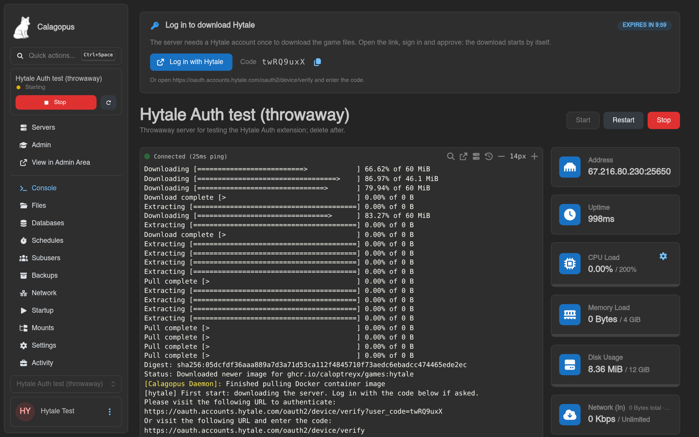
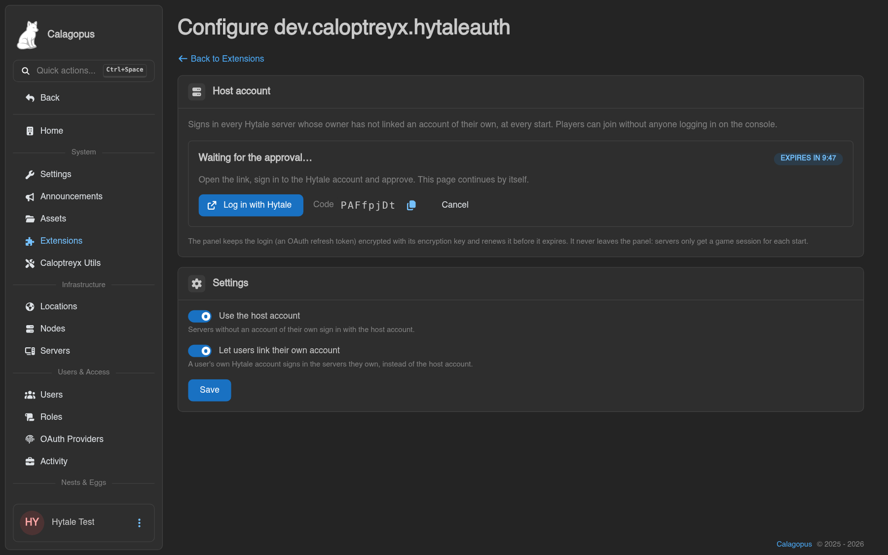
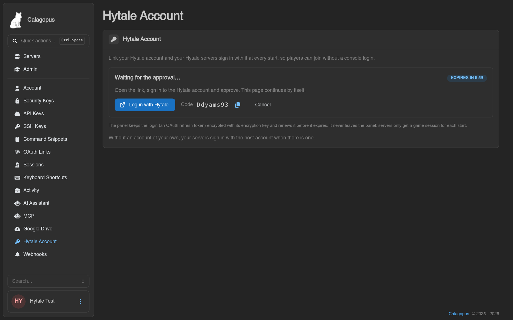
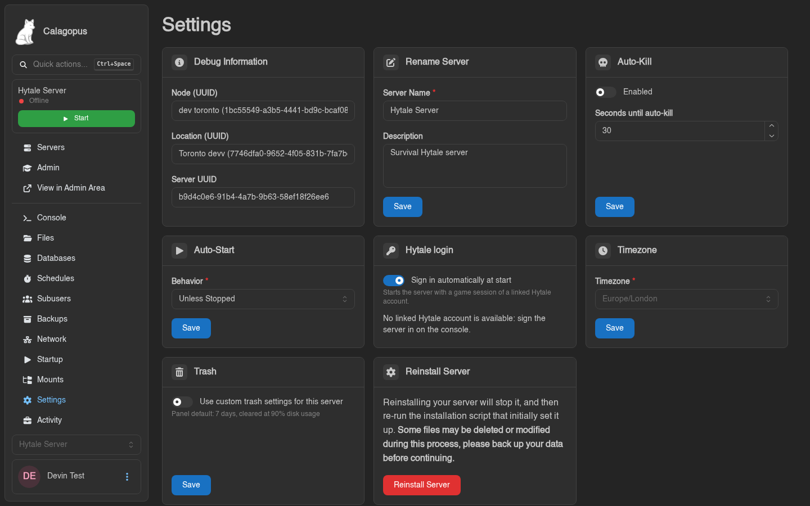

# Hytale Auth

A [Calagopus Panel](https://calagopus.com) extension that makes the Hytale logins of a server
painless. A new Hytale server needs a Hytale account twice: once for the downloader that fetches
the game files, and once for the server itself so players can join. Both are device code logins
printed in the console. This extension does two things:

- **Automatic login (0-click):** with a Hytale account linked in the panel, every start of a
  Hytale server is signed in by the panel. Nobody types `/auth login device`.
- **Console helper:** whatever still needs a console login (the downloader's one-time login, or a
  server without a linked account) becomes a card with a button above the console.

Package name: `dev.caloptreyx.hytaleauth` · Requires panel `>=1.2.10`

Made for servers on the Caloptreyx Hytale egg
([game-eggs `hytale/egg-hytale.yml`](https://github.com/Caloptreyx/game-eggs/tree/main/hytale),
image `ghcr.io/caloptreyx/games:hytale`), and works with any egg that runs `HytaleServer.jar`.

## Screenshots

**Console download login**: one-click Hytale login button, device code, and expiry timer shown above the console.



**Admin host account**: link a shared host Hytale account and control automatic sign-in policies.



**Account linking**: users can link their own Hytale account under **Account → Hytale Account**.



**Server settings**: toggle automatic Hytale sign-in per server.



## Console helper

Above the console of every Hytale server (a start command running `HytaleServer.jar`, or an image
named `hytale`), the extension reads the console output and shows what needs doing:

- **Download login.** On the first start the Hytale downloader prints a link and a code. The card
  shows a **Log in with Hytale** button (the link with the code already filled in), the code with
  a copy button, and a countdown until the code expires. Once the download starts, the card says
  so and goes away.
- **Server login.** When the server runs without a login, the card says that players cannot join
  and offers **Authenticate server**, which sends `/auth login device`. The server's link and code
  then show the same way. After the login went through, the card sends
  `/auth persistence Encrypted` by itself, so the server keeps its login, encrypted in its files,
  across restarts. A login typed by hand in the console is picked up too; the card then offers
  **Keep login after restarts**.
- **Profiles.** When the Hytale account has more than one game profile, the card lists them; a
  click sends `/auth select <number>`.
- **Status.** While the server runs, a slim line shows whether it is signed in, as which profile,
  how (device login, saved login, linked account) and whether the login is saved. **Check status**
  sends `/auth status`.
- **Failures.** An expired code, a cancelled or failed login and tokens the server rejected are
  shown with a way to try again.

Only links to Hytale's own pages (`https://…hytale.com/…`) are ever shown as links.

### Permissions

The card uses the panel's own permissions; the extension adds none for the helper:

- Seeing the card needs `control.read-console` (it reads the console output).
- **Authenticate server**, the profile buttons, **Keep login after restarts** and **Check status**
  send console commands and need `control.console`. Without it the card tells the user to ask
  someone who has console access.
- **Restart** (shown when the downloader's code expired) needs `control.restart`.

## Automatic login

An admin links a **host account** on the extension's page (Admin → Extensions → Hytale Auth).
Users may link **their own account** under Account → Hytale Account. At every start of a Hytale
server the panel picks the account:

1. the server owner's own account, when they linked one;
2. otherwise the host account.

An account that cannot be used (its login died, or no game profile is selected) is skipped, so
a user whose own login expired falls back to the host account. Servers with Auth Mode `offline`
(`AUTH_MODE` or `--auth-mode offline`) and servers whose automatic login was switched off get no
login. The server's settings page shows a **Hytale login** card with the switch (permission
`hytale-auth.manage`), the account the next start uses and how the last start went; the console
card says which account signed the running server in.

### How it works

This is the token passthrough of Hytale's
[Server Provider Authentication Guide](https://support.hytale.com/hc/en-us/articles/45328341414043-Server-Provider-Authentication-Guide)
(Method C). Linking runs the device code flow of the `hytale-server` OAuth client (scopes
`openid offline auth:server`) in the panel: the page shows the link and the code, polls at the
interval Hytale asks for, then loads the account's game profiles (the first is selected, others
can be chosen).

Wings fetches a server's configuration from the panel right before every start. The extension
hooks into that configuration (`RemoteApiServer`): when Wings reports the server as `starting`, it
creates a game session for the account's profile (`/game-session/new`) and adds
`HYTALE_SERVER_SESSION_TOKEN` and `HYTALE_SERVER_IDENTITY_TOKEN` to the container's environment.
`HytaleServer.jar` reads them by itself and starts in `EXTERNAL_SESSION` mode, refreshing the
session every hour while it runs. No egg or image change is needed; the tokens are never part of
the start command, which the console echoes.

The same configuration is built when the panel syncs a server to Wings (after schedule or
startup changes) and when Wings boots. Those get the tokens the running container already has,
so a sync does not flag the server for a restart and no session is created that no server uses.
Wings also reports `starting` for as long as the server boots (and while the downloader waits for
its login), so the session a start handed out is handed out again while it has more than 30
minutes left and the account and profile are unchanged (the panel keeps a SHA-256 digest of it to
recognise it). A quick restart reuses it too. The panel never ends sessions itself, since a
running server may hold them; unused ones expire within the hour.

If anything fails (Hytale unreachable, the login expired, the session limit reached), the server
starts anyway, without tokens. The error is shown on the console card, the server's settings card
and the account, and the console helper takes over.

### What is stored, and how

| Data | Where | How |
| ---- | ----- | --- |
| Refresh token, access token | `dev_caloptreyx_hytaleauth_accounts` | encrypted with the panel's `APP_ENCRYPTION_KEY` (the panel's own encryption, as for node tokens) |
| Device code of a login in progress | `dev_caloptreyx_hytaleauth_links` | encrypted the same way, deleted when the login ends |
| Selected and available game profiles, status, last error | `dev_caloptreyx_hytaleauth_accounts` | plain |
| Automatic login switch, last start result (profile, time, error) | `dev_caloptreyx_hytaleauth_servers` | plain |

Tokens and device codes are never sent to the browser and never logged. The only tokens that leave
the panel are a server's game session tokens, in that server's container environment. Like any
environment variable they are readable by code running in the server (plugins); they belong to
that one server, expire after an hour unless the server refreshes them, and are replaced at every
start. The account's refresh token never reaches a server.

Every OAuth refresh returns a new refresh token and invalidates the old one, so refreshes of one
account never overlap: one at a time per account inside the panel, and a row lock
(`SELECT … FOR UPDATE`) around each refresh for panels with several instances. The new tokens are
stored in the same transaction before the access token is used. Access tokens are reused until 5
minutes before they expire.

### Limits

- **Session limit.** A Hytale game license allows 500 servers running at the same time. Beyond
  that Hytale refuses new game sessions (HTTP 403); the server starts without a login and the
  error says so. Link another account (a user's own, or a second license as host account).
- **30 days.** A refresh token expires after 30 days unused. The panel renews every linked
  account that was not used for 7 days (hourly background task `hytale-auth-keepalive`), so this
  only happens when the panel itself is down that long, or the login is revoked. The account is
  then marked **Needs linking again** and servers fall back to the host account or the console.
- **Downloader.** The panel's login cannot download the game files. The Hytale downloader uses a
  different OAuth client (scope `auth:downloader`) and its credentials file is undocumented, so the
  console helper stays for the downloader's one-time login on a server's first start; afterwards
  the downloader renews its own credentials (`.hytale-downloader-credentials.json`).

### Settings and permissions

- Admin page: **Use the host account** and **Let users link their own account** (both on by
  default). Reading needs `extensions.read`, changing and linking the host account
  `extensions.manage`.
- Server permission `hytale-auth.manage`: turn the automatic login of a server on or off.
- Any user may link their own account while the setting allows it; it signs in only the servers
  they own.

### API

| Method and path | Purpose |
| --------------- | ------- |
| `GET/PUT /api/admin/extensions/dev.caloptreyx.hytaleauth/settings` | settings |
| `GET/DELETE …/host`, `POST/DELETE …/host/link`, `POST …/host/link/poll`, `PUT …/host/profile`, `POST …/host/profiles` | host account: show, unlink, start or cancel a login, poll it, select a profile, reload profiles |
| the same under `/api/client/hytale-auth/account` | the user's own account |
| `GET /api/client/servers/{server}/hytale-auth/status`, `PUT …/automatic` | a server's login status and switch |

## Development

Pure logic lives in `frontend/src/lib`; the console fixtures in `tests/fixtures` are recorded in
the formats the Hytale downloader and server print. From the repository:

```sh
node --test "tests/*.test.ts"
```

With the frontend linked into a panel checkout (`frontend/extensions/dev_caloptreyx_hytaleauth`):
`pnpm typecheck`, `pnpm exec oxlint extensions/dev_caloptreyx_hytaleauth` and
`pnpm exec oxfmt --check extensions/dev_caloptreyx_hytaleauth`. Every push runs the full check
(typecheck, lint, format, frontend build, these tests and `cargo test`) on Blacksmith through
`.github/workflows/check.yml`.

`python3 scripts/package.py` builds `dist/dev_caloptreyx_hytaleauth.c7s.zip` for installing by
hand; releases get the panel's own export from `.github/workflows/release.yml`.

## License

MIT
